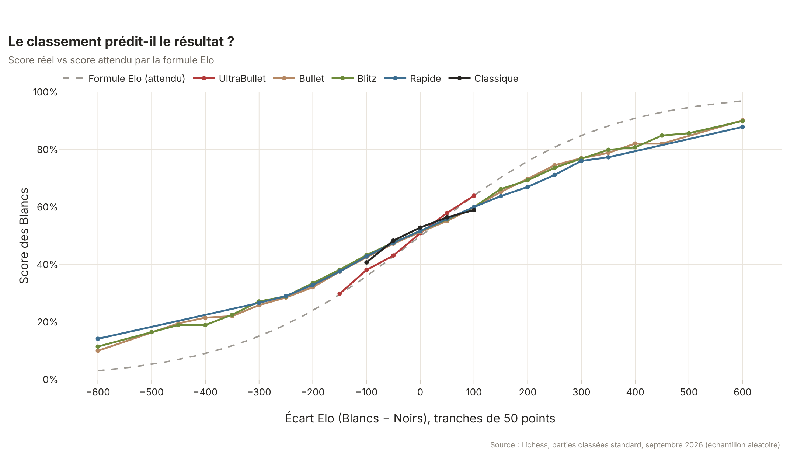
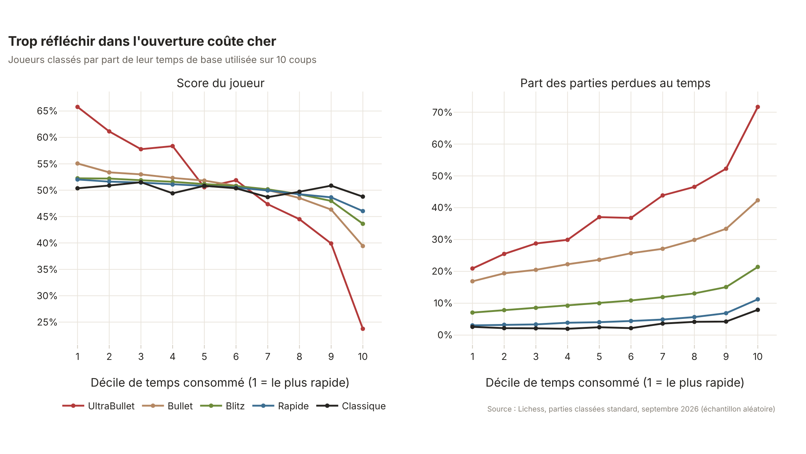
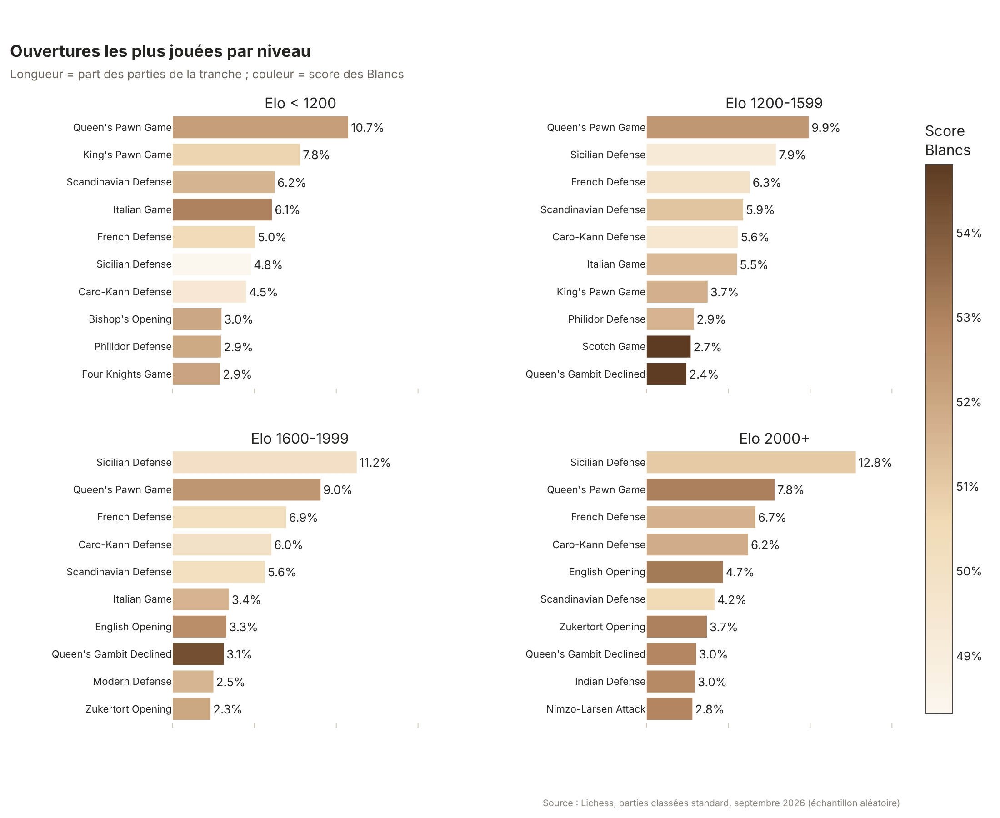
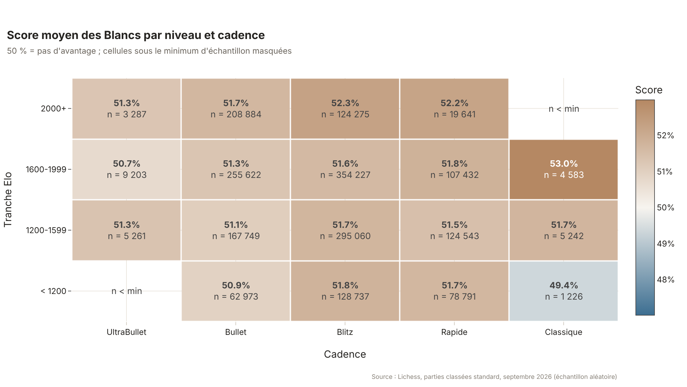
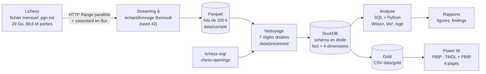

# 64 Squares — Qu'est-ce qui fait vraiment gagner aux échecs ?

**Analyse de 2 millions de parties Lichess, du fichier brut de 29 Go jusqu'au tableau de bord
Power BI, pour mesurer ce qui pèse vraiment sur le résultat : le classement, la couleur, la
gestion de la pendule ou l'ouverture.**

 
 

---

## 1. La question métier

Je joue le rôle d'un data analyst pour une plateforme d'échecs en ligne. Question centrale :
**qu'est-ce qui fait gagner les joueurs à chaque niveau — leur ouverture, leur couleur, leur
gestion du temps, ou simplement leur classement ?**

Six sous-questions, chacune traitée par une requête SQL dédiée (`sql/03_analysis_queries.sql`) :

1. Quelles ouvertures sont jouées à chaque niveau (< 1200, 1200–1599, 1600–1999, 2000+), et avec
   quels taux de victoire, nulle, défaite ?
2. L'avantage des Blancs grandit-il avec le niveau et selon la cadence ?
3. L'écart de classement prédit-il le résultat comme le dit la formule Elo ?
4. Quelle part des parties est perdue au temps ? Réfléchir longtemps dans l'ouverture fait-il
   perdre ?
5. Quand joue-t-on, et joue-t-on moins bien la nuit ?
6. Quels conseils concrets donner à chaque niveau ?

## 2. Résultats clés

Sur **1 958 145 parties** classées de septembre 2026 (échantillon aléatoire du mois, après
nettoyage) — détail et sources de chaque chiffre dans [`reports/findings.md`](reports/findings.md).

- **Le classement est le premier facteur, mais la formule Elo surestime les favoris.** +100 points
  d'écart multiplient les chances de victoire par **1,44**. Pourtant, en blitz, un joueur mieux
  classé de 200 points marque **67,9 %** au lieu des **75,7 %** promis par la formule (−7,8 points).
- **La pendule compte presque autant.** En blitz, les joueurs qui consomment plus de 23 % de leur
  temps sur les 10 premiers coups marquent **43,6 %** contre **52,3 %** pour les plus rapides, et
  perdent au temps **3 fois plus souvent** (21,4 % contre 7,1 %). **31,5 %** de toutes les parties
  se terminent au temps (61 % en bullet sous 1200).
- **L'avantage des Blancs est petit mais constant** : **51,6 %** de score, soit +1,6 point au-delà
  de ce que prédit le classement, de 51,5 % sous 1200 à 51,9 % à 2000+ (maximum : 52,3 % en blitz
  2000+).
- **Le répertoire change radicalement avec le niveau** : la Sicilienne passe de 4,8 % des parties
  sous 1200 à **12,8 %** à 2000+, le « King's Pawn Game » s'effondre de 7,8 % à 0,6 %.
- **L'ouverture pèse très peu sur le résultat** : le test du khi² est significatif (p < 10⁻³⁸)
  mais le **V de Cramér ≤ 0,03** — un effet négligeable. Quelques lignes rapportent toutefois
  **+3 à +5 points** au-delà de l'attendu (partie écossaise jusqu'à 2000 Elo).
- **La nuit coûte des défaites au temps** : 53,9 % des parties de bullet perdues au temps entre 0h
  et 5h UTC contre 50,9 % l'après-midi ; le pic d'activité est à 16h–18h UTC.

| | |
|---|---|
|  |  |
|  |  |

### Tableau de bord Power BI

| Vue d'ensemble | Explorateur d'ouvertures |
|---|---|
|  |  |
| **Elo & gestion du temps** | **Quand joue-t-on ?** |
|  |  |

*(Captures à ajouter après ouverture du projet Power BI.)*

## 3. Recommandations par niveau

| Niveau | Pendule | Ouvertures |
|---|---|---|
| **< 1200** | 61 % des parties de bullet se perdent au temps : privilégier blitz et rapide **avec incrément** | Blancs : partie écossaise (+4,8 pts vs attendu), italienne (+2,8). Noirs : Sicilienne (+1,1) ; éviter 1…Cc6 contre 1.e4 |
| **1200–1599** | Rester sous ~10 % du temps de base sur les 10 premiers coups | Blancs : écossaise (+4,4), gambit dame (+4,3 face au gambit dame refusé). Noirs : Caro-Kann ou Sicilienne |
| **1600–1999** | Préparer une défense pour la jouer vite : aucune défense ne bat l'attendu | Blancs : écossaise (+3,9), gambit dame (+3,3), espagnole (+2,5). Noirs : Caro-Kann, Française, Scandinave |
| **2000+** | Ne pas se fier à la formule Elo contre plus faible (−8 à −10 pts à 200–400 d'écart) | Blancs : systèmes 1.d4 sans c4 (+3,0), Anglaise (+2,8) |

Pour tous : éviter les longues sessions de nuit en bullet et blitz (+2 à +3 points de défaites au
temps à cadence égale).

## 4. Données & méthodologie

Résumé ci-dessous, détail complet dans [`docs/methodology.md`](docs/methodology.md) et
[`docs/data_dictionary.md`](docs/data_dictionary.md).

- **Source** : base ouverte Lichess (licence CC0), fichier `.pgn.zst` de septembre 2026 :
  **29,2 Go compressés (~200 Go décompressés), 89 616 462 parties**. Référentiel d'ouvertures
  `lichess-org/chess-openings` pour regrouper les ouvertures en familles.
- **Streaming d'un fichier énorme** : le fichier n'est jamais écrit sur disque. Téléchargement
  par requêtes HTTP Range parallèles, décompression zstandard à la volée, découpage des parties
  au niveau des octets (~350 Mo/s), reprise automatique après coupure.
- **Échantillonnage** : tirage de Bernoulli reproductible (graine 42, p = 2,2 %) →
  **2 000 201 parties**, écrites en lots Parquet de 100 000 avec point de reprise. Les pseudos
  sont **hachés (SHA-256 salé)** dès l'ingestion.
- **Nettoyage** (7 règles testées, comptages avant/après documentés) : parties classées
  standard, fins normales ou au temps, au moins 10 demi-coups, pas de BOT, classements valides
  (400–3200), cadence valide (hors correspondance) → **1 958 145 parties (97,9 %)**.
- **Règle du minimum d'échantillon** : aucun taux n'est affiché (SQL, Python, Power BI) pour un
  groupe de moins de **1 000 parties** (paramétrable).
- **Statistiques** : intervalles de Wilson à 95 %, khi² + V de Cramér, calibration Elo avec
  erreur absolue moyenne, régression logistique (statsmodels).
- **Contrôles** : 116 tests automatisés ; recoupement SQL ↔ Python (score des Blancs par
  tranche, top-3 des ouvertures) : **6/6 identiques**.

## 5. Architecture



## 6. Stack technique

| Étape | Outils |
|---|---|
| Ingestion | Python 3.11+, `requests`, `zstandard`, `numpy`, `pyarrow`, `python-chess` (validation) |
| Nettoyage | `pandas`, référentiel `lichess-org/chess-openings` |
| Base analytique | **DuckDB** (SQL : CTE, fonctions de fenêtre, `GROUPING SETS` / `ROLLUP`) |
| Statistiques | `scipy`, `statsmodels` |
| Visualisation | `plotly` + `kaleido` (PNG), notebook Jupyter |
| BI | **Power BI Desktop** — projet `.pbip` : modèle TMDL, rapport PBIR, mesures DAX, thème personnalisé |
| Qualité | `pytest` (116 tests), `ruff`, validation des schémas PBIR et du TMDL |

```
64-Squares/
├── config.yaml            # mois, taille d'échantillon, graine, seuils
├── run.py / Makefile      # ingest, clean, model, analyze, export, test, all
├── src/eloscope/          # ingest, clean, openings, model, analyze, charts, export_gold
├── sql/                   # 01_schema, 02_views, 03_analysis_queries
├── notebooks/             # 01_exploration.ipynb (EDA, sorties enregistrées)
├── tests/                 # 24 parties de test + tests unitaires et d'intégration
├── reports/               # findings.md, figures/, tables/ (une table par requête)
├── powerbi/               # EloScope.pbip, modèle TMDL, rapport PBIR, theme.json, BUILD_GUIDE.md
├── tools/                 # génération et validation du projet Power BI
└── docs/                  # methodology.md, data_dictionary.md
```

## 7. Lancer le projet

```bash
python -m venv .venv && source .venv/bin/activate   # Windows : .venv\Scripts\activate
pip install -r requirements.txt
cp .env.example .env                                # puis renseigner HASH_SALT (valeur aléatoire longue)
python run.py all                                   # ou : make all
```

`run.py all` enchaîne `ingest → clean → model → analyze → export → test`. La première ingestion
lit le fichier de 29 Go en flux (~30 min, ~2 Go d'espace disque au total) ; les exécutions suivantes
utilisent le cache de l'échantillon et prennent **~3 minutes**. Chaque étape peut être lancée
seule (`python run.py clean`). Les images des graphiques nécessitent Chrome/Chromium pour
`kaleido` (sinon `plotly_get_chrome`, ou `python run.py analyze` après avoir défini
`BROWSER_PATH`).

**Power BI** (détail dans [`powerbi/BUILD_GUIDE.md`](powerbi/BUILD_GUIDE.md)) :

1. Générer les CSV : `python run.py all` (le fichier `fact_games.csv` de ~200 Mo n'est pas
   versionné et doit être régénéré).
2. Ouvrir `powerbi/EloScope.pbip` dans Power BI Desktop.
3. *Transformer les données > Modifier les paramètres* : `DataFolder` = chemin absolu de
   `data/gold\`, puis **Actualiser**.

## 8. Limites

- **Un seul mois** de données (septembre 2026) : pas de saisonnalité ni d'évolution dans le temps.
- **Les joueurs en ligne ne représentent pas tous les joueurs** : plus jeunes, cadences rapides,
  classements Lichess (Glicko-2) différents des classements FIDE.
- **Échantillonnage** : 2,2 % du mois ; les marges d'erreur sont indiquées et les petits groupes
  (< 1 000 parties) masqués.
- **Données d'horloge** absentes pour 3,2 % des parties (moins de 20 demi-coups, base de 0 s).
- **Corrélation ≠ causalité** : un joueur qui réfléchit longtemps peut déjà être en difficulté ;
  une famille d'ouverture résulte des choix des deux joueurs.

## 9. Licence des données & contact

Données : [base ouverte Lichess](https://database.lichess.org), domaine public (**CC0**) ;
référentiel d'ouvertures [lichess-org/chess-openings](https://github.com/lichess-org/chess-openings)
(CC0). Les pseudos sont hachés et aucun joueur individuel n'apparaît dans les rapports.

**Oussama Essalehi** — [linkedin.com/in/oussama-essalehi](https://www.linkedin.com/in/oussama-essalehi) ·
[oussama-essalehi.dev](https://oussama-essalehi.dev)
